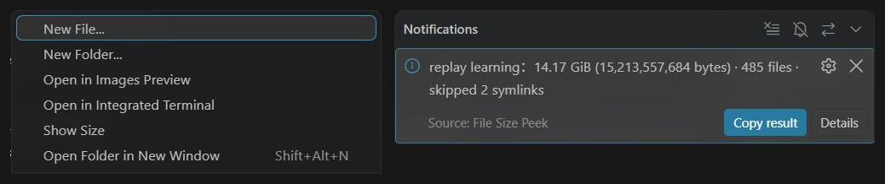

# File Size Peek

**English** | [简体中文](README.zh-CN.md)

Right-click a file or folder in VS Code's Explorer and select **Show Size**.

The notification shows a readable size and the exact byte count. For folders, the extension recursively counts files in subfolders, including hidden files, and displays the file count. Select **Copy result** to copy the size and full path, or **Details** to open the output panel. Folder scans can be cancelled; starting another scan cancels the previous one.

## Screenshot



Actual usage in a Remote-SSH workspace: the Explorer context menu on the left and the folder-size notification on the right. Both views are cropped for readability.

## Install

Download `file-size-peek-0.1.0.vsix` from [GitHub Releases](https://github.com/Steve2457/file-size-peek/releases). In VS Code, run **Extensions: Install from VSIX…** and select the package.

Local workspaces on Windows, macOS and Linux are supported. For Remote-SSH, WSL or Dev Containers, install the extension in the **remote extension host**. Size scans run on the machine where the files reside.

## How sizes are calculated

- Files use the logical byte size reported by the filesystem, displayed in B, KiB, MiB, GiB and larger units. 1 KiB = 1024 bytes.
- Folder sizes are the sum of all regular file sizes, including subfolders and hidden files. Directory metadata is excluded.
- Folder scans skip symbolic links and directory junctions to avoid cycles and following links outside the selected folder. The notification reports the number of skipped links. Selecting a symbolic link directly shows the link's own size.
- Hard links are counted once per pathname; sparse files use their logical length. Results may therefore exceed allocated disk space or the output of `du`. Mount points inside the folder are traversed normally.
- Read failures are labelled **at least** and **incomplete result**. Details retain up to 20 read errors. Cancelling a scan does not present partial counts as a final result.
- A scan reflects filesystem contents as they are read. Files changing during the scan can affect the result. Unsaved editor changes are excluded.

Only regular local and remote filesystems are supported. The menu is not shown for Git history or virtual filesystems. There are no background scans, telemetry, file modifications or runtime dependencies.

## Development

Use Node.js 22+:

```sh
npm test
npm run package -- --out ../file-size-peek-0.1.0.vsix
```

MIT License. Copyright © 2026 v-junanhu.
