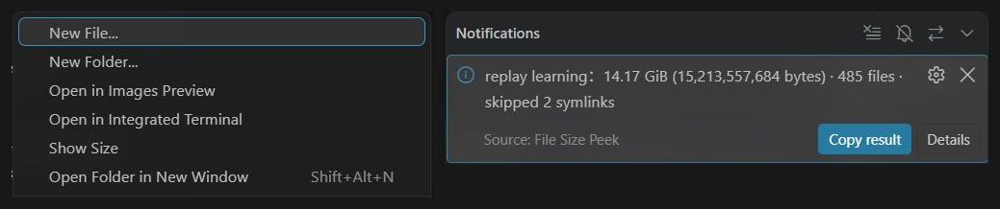

# File Size Peek

[English](README.md) | **简体中文**

在 VS Code 文件资源管理器中，右键任意文件或文件夹，选择 **查看大小**。

通知展示大小和精确字节数。文件夹会递归统计子目录及隐藏文件，并展示文件数量。点击 **复制结果** 可复制大小与完整路径；**查看详情** 打开输出面板。大目录统计过程中可以取消。重新对另一项执行命令会取消上一次统计。

## 使用截图



在 Remote-SSH 工作区中实际运行：左侧为文件资源管理器的右键菜单，右侧为文件夹大小通知。两处截图均已裁剪，便于阅读。

## 安装

在 [GitHub Releases](https://github.com/Steve2457/file-size-peek/releases) 下载 `file-size-peek-0.1.0.vsix`。运行 **Extensions: Install from VSIX…（扩展：从 VSIX 安装）** 并选择安装包。

支持 Windows、macOS 和 Linux 本地工作区。使用 Remote-SSH、WSL 或 Dev Containers 时，请安装到**远程扩展主机**；统计在文件所在主机执行。

## 语言

插件支持英文和简体中文，界面跟随 VS Code 的显示语言。切换时，在命令面板运行 **Configure Display Language（配置显示语言）**，按 VS Code 提示操作。

点击本页顶部的语言链接，可以切换阅读英文或中文文档。

## 大小如何计算

- 文件显示文件系统报告的逻辑字节数，使用 B / KiB / MiB / GiB 等单位，1 KiB = 1024 字节。
- 文件夹显示所有普通文件逻辑大小之和，包含子目录及隐藏文件，不包含目录自身的元数据占用。
- 文件夹内不跟随符号链接和目录联接，避免循环或跟随链接统计到目录以外；通知会显示跳过的链接数。直接选择符号链接时显示链接本身的长度。
- 硬链接按每个文件路径分别计数；稀疏文件按逻辑长度计数，因此结果可能大于实际磁盘占用或 `du` 的输出。目录内的挂载点会正常遍历。
- 读取失败时显示“至少”和“结果不完整”，详情保留最多 20 条读取错误。取消不会展示部分结果为最终大小。
- 统计是当前文件系统的遍历结果，文件同时变化时可能与稍后读取的大小不同。未保存的编辑器内容不计入。

仅支持普通本地/远程文件系统，Git 历史和虚拟文件系统不显示菜单。无后台扫描、无遥测，不修改文件，无运行时依赖。

## 开发与打包

使用 Node.js 22+：

```sh
npm test
npm run package -- --out ../file-size-peek-0.1.0.vsix
```

MIT 许可证。Copyright © 2026 v-junanhu。
